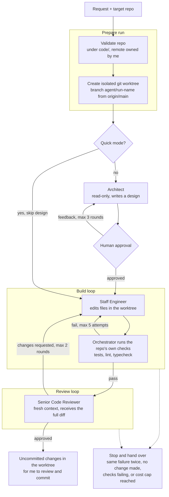
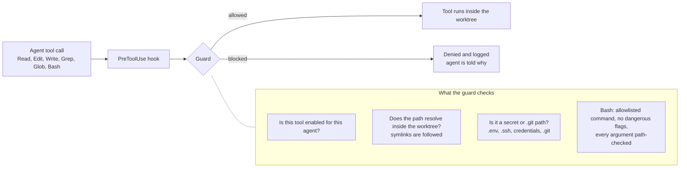

# agent-team

A multi-agent software engineering team built on the Claude Agent SDK, in TypeScript.
An Architect designs, a Staff Engineer builds, and a Senior Code Reviewer checks the work. Each run targets one repo, works only inside its own git worktree, and never commits.

The interesting part is the containment. Agents get real tools (read, edit, run tests), so every tool call passes through a guard that decides whether it may run, and every loop has an exit condition that hands control back to a human.

## How it works

**Three ideas hold it together:**

- **The orchestrator verifies, not the agents.** After each Engineer attempt the orchestrator runs the repo's own checks itself and feeds the failing output back. It never takes the Engineer's word that tests pass. Checks that already fail before any change are not used as a gate, so the loop cannot burn attempts on a broken environment.
- **The Reviewer is independent.** Each review is a fresh session. It is handed the full diff (new files included) plus the design or request, and it can read the repo, but it never sees the Engineer's reasoning.
- **Every loop can stop.** Hard caps on attempts and rounds, stuck detection (the same failure or the same review fixes twice, or no change made), and a per-run cost cap. Every exit says why and hands the decision to a human.

## The agents

| Agent | Can do | Cannot do |
|---|---|---|
| **Architect** | Read, search | Edit, run commands |
| **Staff Engineer** | Read, search, edit and write files in the worktree, run allowlisted checks | Stage, commit, push, touch `.git` or secrets |
| **Senior Code Reviewer** | Read, search, run allowlisted checks | Edit anything |

All three return schema-validated output (zod), so a malformed handoff fails immediately instead of reaching the next agent.

## Keeping the agents contained

| Layer | What it does |
|---|---|
| Repo check | Name must match `[a-z0-9._-]`, be a direct child of `code/`, and have a remote owned by my GitHub account |
| Worktree | Each run gets its own worktree and branch cut from origin's default branch. The main checkout is never edited |
| Path guard | File tools must resolve (symlinks included) inside that worktree |
| Secret and `.git` deny | `.env*` (except `.env.example`), `.ssh`, `credentials`, `.aws`, `.databrickscfg`, and anything under `.git` are always blocked |
| Bash allowlist | Read-only git, tests, lint, typecheck, `ls`. Agents cannot stage, commit or push |
| Bash arguments | Every argument is path-checked. No `$`, quotes, backslashes, braces, `~`, pipes or redirects. Flags that read or write elsewhere (`git diff --no-index`, `--output`, `--fix`) are denied, and `npx` needs `--no-install` |
| Two enforcement points | The guard runs as a `PreToolUse` hook (which fires for every call) and again in `canUseTool` as a backstop |
| Isolation | No user settings loaded, a minimal environment, and per-agent turn and cost caps |

## Modes

- **Full flow:** worktree, Architect design, human approval, build loop, review loop.
- **Quick mode:** skips the Architect and the approval gate for small, clear requests. Because nobody approves a design, the Engineer may decline a request that touches more than about three files or is ambiguous. It then changes nothing and the Reviewer is skipped, so no usage is wasted. In one like-for-like comparison, skipping the Architect cut estimated usage by about 40%.
- **Plan only:** stop after the approved design.
- **Review:** review whatever changed in an existing worktree.
- **Cleanup:** remove a run's worktree and branch. It refuses if there are uncommitted changes, even when forced, and refuses unmerged commits unless forced (a squash-merged PR looks unmerged).

## Measuring runs

Every agent call is recorded: turns, estimated cost, blocked tool calls, and time. Each run prints a table and saves a `metrics.json`. The cost figures are the SDK's estimate at API prices. On a subscription they are usage against plan limits, not a bill.

This is how I found that blocked commands were wasting turns: 5 blocked calls in the first live run, and 0 in every run after the agents were told exactly which commands work. It also suggests that cost is driven more by per-session overhead than by turn count, which is a hypothesis I have not tested.

## Tests

117 tests run in a couple of seconds, with no API calls (agents are faked). Most of them cover the guard and the loops, because that is where mistakes are expensive: symlink and `..` escapes, secret files, the Bash exploits found in review, every loop exit condition, and the safety rules of worktree cleanup.

Tests with fake agents are not enough on their own. The first live runs found three bugs the tests had missed (a schema the CLI rejected, an auth error hidden inside a "success" result, and a guard that blocked the SDK's own output tool). A security review before publishing found a real hole in the Bash check, covered below.

## Security model and known limits

This is a guard around an agent's tool calls, **not an OS sandbox**.

- **Repo code still runs.** `npm test`, `pytest`, `ruff` and the like execute code from the target repo. If the repo is malicious or compromised, or an agent writes a malicious test, that code runs with my user's permissions. The orchestrator also runs the repo's checks itself, outside the guard. It is meant for repos I trust. Real isolation would need a container or VM.
- **Prompt injection.** Repo contents are fed to the agents. The guard limits what a manipulated agent can touch, but it cannot stop a bad edit inside the worktree, which is why agents never commit and a human reads the diff.
- **Pinned to one owner.** The repo check only accepts remotes owned by my GitHub account.
- **Local, attended use only.** Auth is a Claude subscription login. Anthropic's Consumer Terms restrict automated access unless an API key is used or they explicitly permit it, so unattended or cloud runs are out of scope by design.

The security review found that the original Bash check only looked at the start of each command, so allowed commands could read, list and write outside the worktree (for example `git diff --no-index ~/.ssh/id_rsa /dev/null`). It is fixed, and the exploits stay in the test suite as regression tests.

## Design decisions

- **No Product Strategy Advisor.** The Architect already covers scoping. A fifth agent would add usage without a task that needs it.
- **Agents never commit.** Changes stay uncommitted in the worktree until a human reviews them.
- **Subscription auth by default.** An API key in the environment is deliberately not forwarded, so it can never silently override the subscription and bill the API.
- **Verification is the orchestrator's job.** Agent claims about tests are never trusted.
